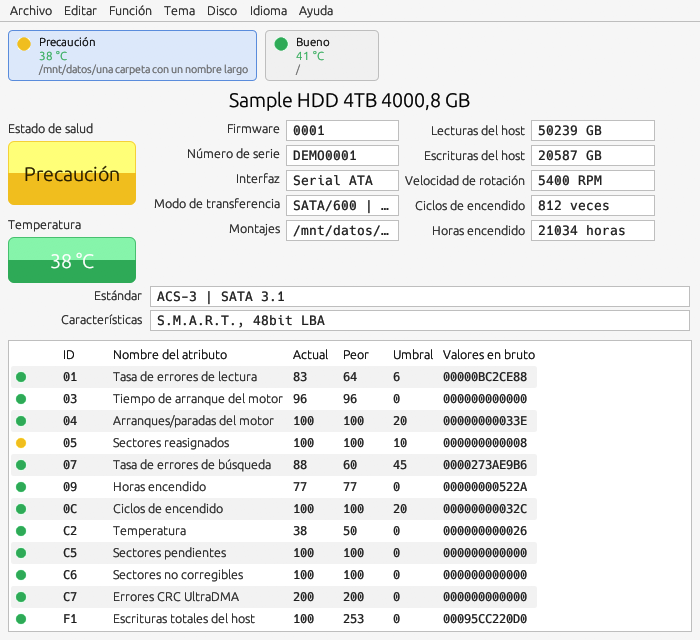

# CrystalDiskInfo for Linux

A Linux desktop app that shows the health (S.M.A.R.T.) and temperature of your disks, in the
style of [CrystalDiskInfo](https://github.com/hiyohiyo/CrystalDiskInfo) by hiyohiyo.

*Español más abajo.* Download the AppImage from the
[Releases page](https://github.com/AsturTorQue/Diskinfo-for-linux/releases).



## Features

- One tab per disk (SATA, NVMe, USB) with its health status and temperature.
- Health status **Good / Caution / Bad / Unknown**, with remaining life for SSDs, using the same
  rules as CrystalDiskInfo (see [MECHANICS.md](MECHANICS.md)).
- Firmware, serial number, interface, transfer mode, mount points, host reads/writes,
  rotation rate, power-on count and hours, standard and features.
- Full S.M.A.R.T. attribute table, with a colour per attribute and hover help.
- Adjustable warning thresholds per disk (reallocated / pending / uncorrectable sectors,
  SSD life, temperature alarm).
- Auto refresh, copy a text report, Fahrenheit, green mode.
- 6 languages (Español, English, Português, Français, Deutsch, Italiano) and 6 themes.
- Optional passwordless reading through a narrow polkit rule (see below).

## Requirements

- Linux x86_64 with a graphical desktop (Wayland or X11).
- `smartmontools` (`smartctl`) to read S.M.A.R.T.: `sudo dnf install smartmontools`,
  `sudo apt install smartmontools`, `sudo pacman -S smartmontools`...
- `polkit` (`pkexec`), present on almost every desktop distribution.

## Administrator rights and passwordless mode

Linux only lets root talk to disks directly, so reading S.M.A.R.T. needs administrator rights.
The app asks once per read through `pkexec`. Without it you still see model, serial, firmware,
size, mount points and the temperature of NVMe drives.

**Function → Read without password…** installs `/etc/polkit-1/rules.d/49-crystaldiskinfo-linux.rules`
(asking for the password once). The rule lets only your user, at a local active session, run
exactly `smartctl -j -a /dev/<disk>`. Nothing else: no other programs, no changing disk settings,
no self-tests. The same window removes it.

## Build

Install Rust from <https://rustup.rs>, then:

```sh
cargo build --release
./target/release/info-discos
```

Options: `--lang es|en|pt|fr|de|it`, `--theme light|dark|mint|ocean|sakura|contrast`,
`--demo` (two sample disks), `--screenshot file.png` (draw, save a picture and exit).

Run the tests with `cargo test`.

### AppImage

Download [appimagetool](https://github.com/AppImage/appimagetool/releases), then:

```sh
packaging/build-appimage.sh /path/to/appimagetool
```

The result is `dist/CrystalDiskInfo_for_Linux-x86_64.AppImage`. On first start the app adds itself
to your application menu (`~/.local/share/applications`), which also gives its window the right
icon on Wayland. Turn it off in **File → Show in the application menu**.

## Project layout

| Path | What it is |
|------|------------|
| `src/main.rs` | Window, menus and settings |
| `src/disks.rs` | Finding disks (`lsblk`, `/sys`) and reading `smartctl` JSON |
| `src/health.rs` | Health and temperature rules |
| `src/i18n.rs` | Translations and help texts |
| `src/theme.rs` | Colour themes |
| `src/polkit.rs` | Optional passwordless rule |
| `src/integrate.rs` | Application-menu entry and icon |
| `src/demo.rs` | Sample disks for `--demo` |
| `packaging/` | Icon, desktop entry and AppImage script |

## Credits and license

Based on CrystalDiskInfo, Copyright (c) 2008-2023 hiyohiyo (MIT, see
[LICENSE-CrystalDiskInfo.txt](LICENSE-CrystalDiskInfo.txt)). This program is a new implementation
in Rust and is not affiliated with the original author. Released under the MIT License
(see [LICENSE](LICENSE)).

---

## Español

Clon de CrystalDiskInfo para que los usuarios de Linux puedan usarlo de una manera familiar:
muestra la salud (S.M.A.R.T.) y la temperatura de tus discos, al estilo de CrystalDiskInfo de hiyohiyo.

Descarga el AppImage desde la página de versiones (Releases) del repositorio:
<https://github.com/AsturTorQue/Diskinfo-for-linux/releases>

- **Necesita** `smartmontools` y `polkit`. Leer el S.M.A.R.T. requiere permisos de
  administrador; la app los pide con `pkexec`, o puedes activar **Función → Lectura sin
  contraseña…**, que instala una regla que solo permite a tu usuario leer los datos del disco.
- **Compilar:** instala Rust desde <https://rustup.rs> y ejecuta `cargo build --release`.
- **AppImage:** `packaging/build-appimage.sh /ruta/a/appimagetool`.
- **Idiomas:** español, inglés, portugués, francés, alemán e italiano. **Temas:** claro, oscuro,
  menta, océano, sakura y alto contraste.
- **Licencia:** MIT. Basado en CrystalDiskInfo (MIT, © hiyohiyo).
